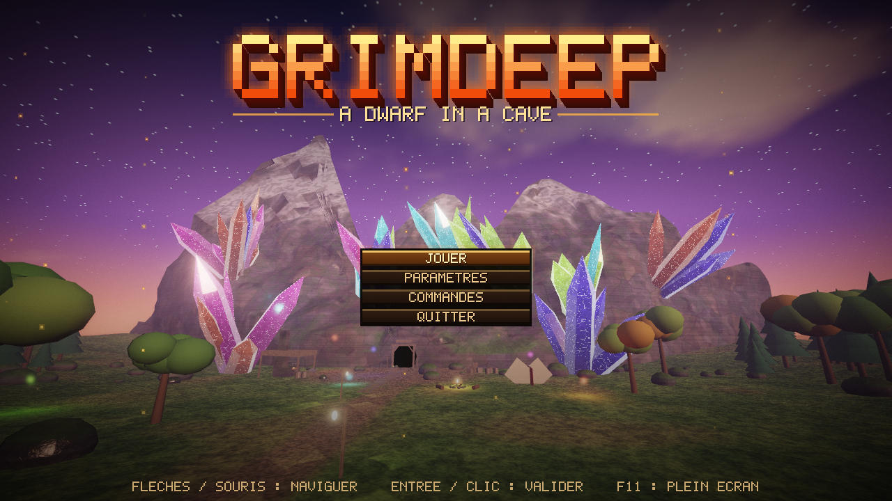
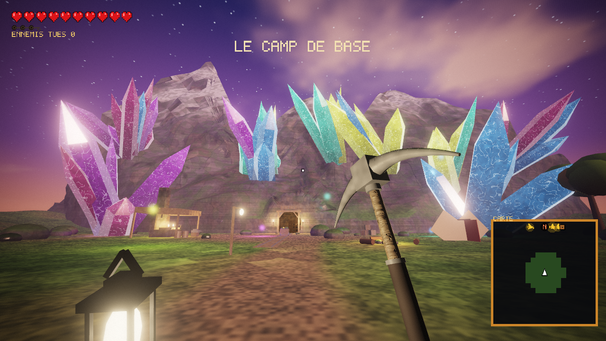
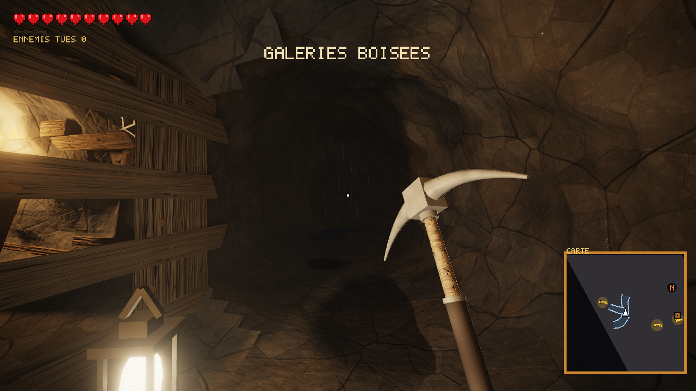
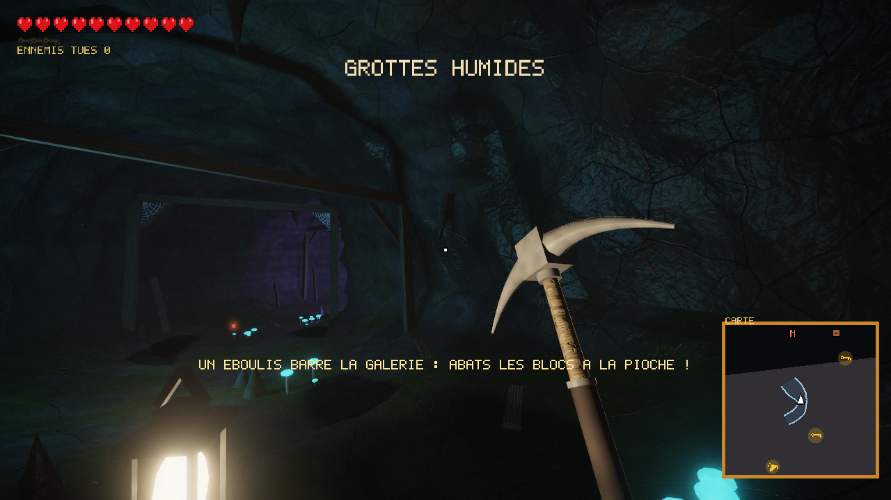
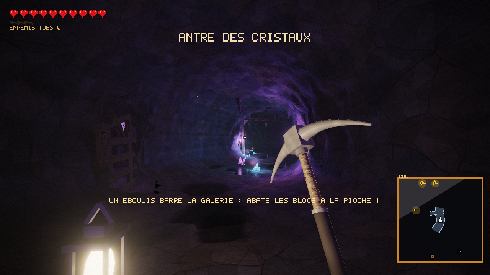
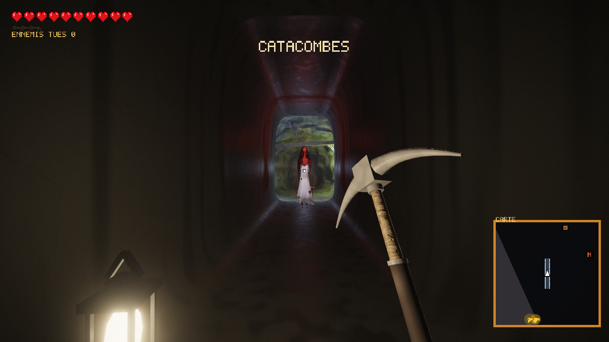
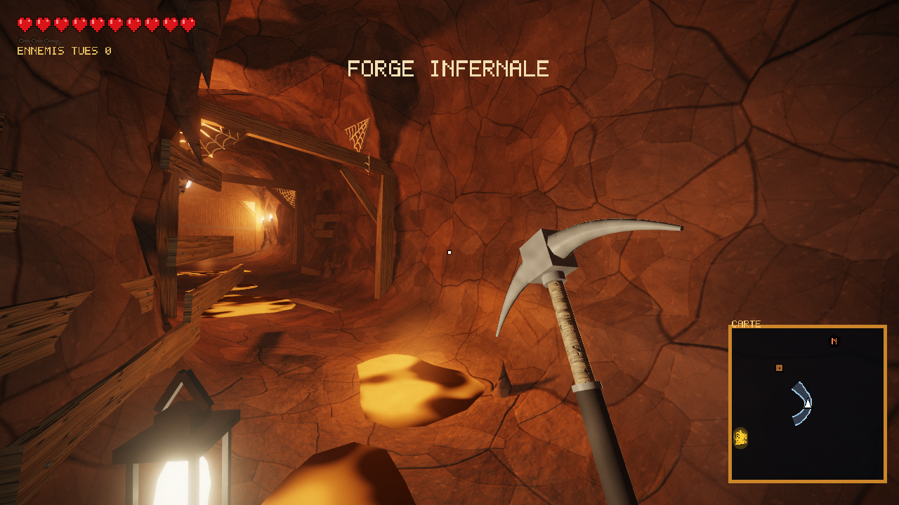
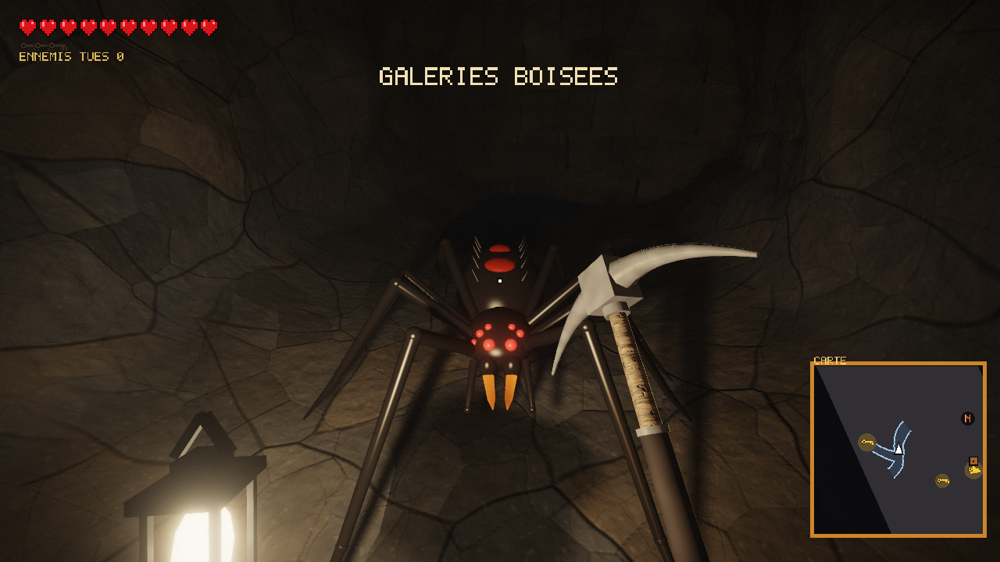
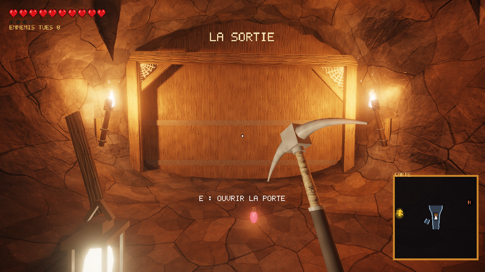
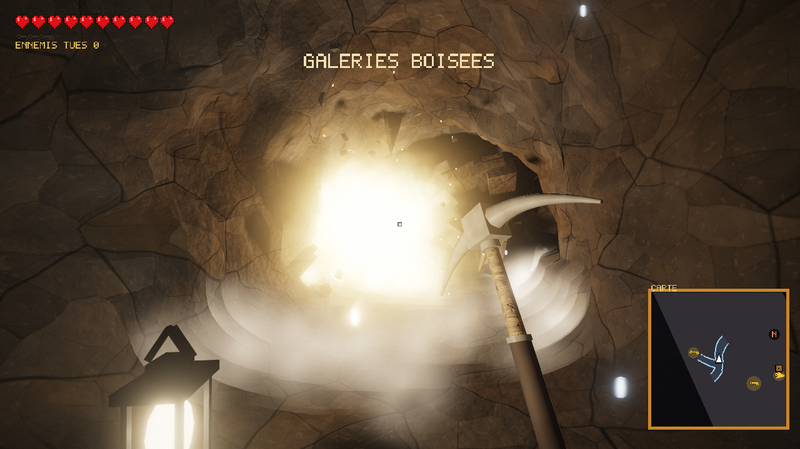

# GRIMDEEP — *A Dwarf in a Cave*

Jeu d'exploration souterraine en vue subjective, écrit en **C++17 / OpenGL 4.3**.
Vous incarnez un nain qui quitte son camp de base au crépuscule pour descendre dans une mine
générée procéduralement : cinq biomes à traverser, trois clés à trouver, une grande porte à ouvrir
et, au bout, la lumière du jour.

Tout est procédural — galeries, décors, textures, musique et effets sonores sont calculés à partir
d'une graine : chaque partie se joue dans une grotte différente.



▶ **Vidéo de présentation :** [youtube.com/watch?v=Gija0DmpHX8](https://www.youtube.com/watch?v=Gija0DmpHX8)

[](https://www.youtube.com/watch?v=Gija0DmpHX8)

---

## Sommaire

- [Aperçus](#aperçus)
- [But du jeu](#but-du-jeu)
- [Commandes](#commandes)
- [Installation et compilation](#installation-et-compilation)
- [Lancement](#lancement)
- [Contenu du jeu](#contenu-du-jeu)
- [Options de lancement (tests)](#options-de-lancement-tests)
- [Organisation du projet](#organisation-du-projet)
- [Pour les développeurs](#pour-les-développeurs)

---

## Aperçus

| | |
|---|---|
|  **Le camp de base** au crépuscule |  **Galeries boisées** |
|  **Grottes humides** |  **Antre des cristaux** |
|  **Catacombes** — quelqu'un vous attend au bout du couloir… |  **Forge infernale** |
|  **Araignée géante** |  **La grande porte** (3 clés) |
|  **Dynamite** | |

## But du jeu

1. Partez du **camp de base** (plaine, forêt, forge, chariot de minerai…) et entrez dans la mine
   à flanc de montagne.
2. Traversez les **5 biomes** en abattant à la pioche les **éboulis** qui barrent les galeries.
3. Trouvez les **3 clés**, cachées au fond des galeries latérales et gardées par des ennemis.
   La minicarte (en bas à droite) indique toujours où elles se trouvent.
4. Ouvrez la **grande porte** au bout de la galerie principale (touche **E**).
5. Rejoignez la **lumière de la sortie**.

Vous disposez de 100 PV (10 cœurs). Les fioles rouges rendent 35 PV.

## Commandes

| Touche | Action |
|---|---|
| **Z Q S D** / **W A S D** / flèches, souris | se déplacer, regarder |
| **Maj** | courir (accélération progressive, champ de vision élargi) |
| **Espace** | sauter (monter, en vol libre) |
| **Clic gauche** | coup de **pioche** (portée 3,2 m) : abat les blocs d'éboulis et les planches, repousse et blesse les monstres |
| **E** | ouvrir la grande porte (avec les 3 clés) |
| **G** | **dynamite** : tout explose dans un rayon de 6,5 m |
| **F** | basculer marche / vol libre (Espace et Ctrl pour monter et descendre) |
| **R** | nouvelle grotte (retour au camp) |
| **Entrée** | recommencer après la mort ou la victoire |
| **Echap** | pause (reprendre, paramètres, commandes, menu principal, quitter) |
| **F11** | plein écran / fenêtré |
| **F12** | capture d'écran (`capture_<heure>.png`) |

Dans les menus : flèches ou souris pour naviguer, Entrée ou clic pour valider, flèches gauche / droite
pour régler les curseurs.

## Installation et compilation

Le projet se compile sous **Windows** avec **MSYS2 / MinGW-w64** (g++).

### 1. Prérequis (une seule fois)

1. Installer [MSYS2](https://www.msys2.org/) dans `C:\msys64` (emplacement par défaut).
2. Dans le terminal **MSYS2 MINGW64**, installer le compilateur et les bibliothèques :

   ```bash
   pacman -S mingw-w64-x86_64-gcc mingw-w64-x86_64-glfw mingw-w64-x86_64-glew mingw-w64-x86_64-glm
   ```

3. Une carte graphique compatible **OpenGL 4.3**.

| Dépendance | Rôle |
|---|---|
| GLFW 3 | fenêtre, clavier, souris |
| GLEW | chargement des fonctions OpenGL |
| GLM | mathématiques (vecteurs, matrices) |
| WinMM (fournie par Windows) | sortie audio |

### 2. Compiler

Double-cliquer sur **`build.bat`**, ou dans un terminal à la racine du projet :

```bat
build.bat
```

L'exécutable est produit dans `build\grimdeep.exe` (compilation complète en ~30 s).

**Variante CMake** (compilation incrémentale, pratique dans un IDE) :

```bash
cmake -S . -B build -G "MinGW Makefiles" -DCMAKE_BUILD_TYPE=Release
cmake --build build -j
```

## Lancement

Double-cliquer sur **`run.bat`**, ou :

```bat
run.bat                       :: lance le jeu (plein écran par défaut)
run.bat --windowed            :: en fenêtre
run.bat --seed 42             :: une grotte précise
```

Le jeu a besoin du dossier `assets/` (shaders et modèles 3D). Il le trouve automatiquement s'il est
lancé depuis la racine du projet, depuis `build/` ou par double-clic sur l'exécutable.
Les réglages (volumes, sensibilité de la souris, plein écran) sont enregistrés dans `settings.ini`,
à la racine du projet ; supprimer ce fichier rétablit les valeurs par défaut.

## Contenu du jeu

### Le monde
- **Camp de base au crépuscule** : relief, chemin de terre, forêt, forge sous auvent, feu de camp,
  tente, chariot sur rails, caisses et tonneaux. Jeu de lumière : les **cristaux géants** de la
  montagne changent lentement de couleur, une onde de luminosité les parcourt, 5 orbes colorées
  dérivent au-dessus de la place et 3 projecteurs balaient la façade ; étoiles qui scintillent,
  feux qui « respirent ».
- **5 biomes souterrains**, puis la zone de sortie, avec des transitions progressives. Chacun a sa
  palette, son ambiance et **sa musique** :

  | Biome | Ambiance |
  |---|---|
  | Galeries boisées | soutènements en bois, torches orangées |
  | Grottes humides | mousse, champignons luminescents, torches bleues |
  | Antre des cristaux | cristaux émissifs à facettes, lueurs violettes |
  | Catacombes | ossements, torches vertes, long couloir lisse et inquiétant |
  | Forge infernale | flaques de lave, torches rouges |

- **Boisage destructible** : cadres de soutènement (un cadre privé de ses poteaux s'effondre),
  coffrage, échelles et **barricades** (2 coups de pioche, elles tombent d'un bloc), planches au sol.
  Le bois détruit noircit au bout de quelques secondes, braise, puis part en cendres.
- **Éboulis** : murs de blocs de pierre (en quinconce, sur plusieurs épaisseurs) qui bouchent toute
  la galerie — jusqu'à 5 sur la galerie principale et 1 par galerie latérale. Chaque bloc encaisse
  2 coups ; un bloc qui perd son appui s'écroule. Les gravats s'effritent 10 s après leur chute,
  dès qu'on ne les regarde plus.
- **Vie de la mine** : gouttes d'eau qui tombent des stalactites, flaques, toiles d'araignée, rats
  qui passent d'un trou à l'autre.

### Combat
- **Ennemis** : rôdeurs (3 PV), araignées géantes (2 PV, rapides), golems de lave (6 PV, très
  dangereux). Ils s'éveillent à portée et attaquent **en 3 temps** (armement, fente, récupération) :
  on peut esquiver. Ils lâchent parfois une fiole.
- **Impacts** : arrêt sur image, secousse de caméra, ennemi qui clignote, recule et reste sonné ;
  à la mort, **ragdoll** (le corps bascule et rebondit, les membres pendent et traînent au sol).
- **Dynamite (G)** : le bâton rebondit, la mèche crépite et éclaire les parois, puis explosion —
  éclair, boule de feu, onde de choc, étincelles et braises, fumée noire, éclats de roche, lumière
  qui projette des ombres, ralenti, oreilles qui sifflent, souffle qui repousse le joueur. Tout
  est détruit dans un rayon de 6,5 m ; le sol brûle encore quelques secondes.

### Interface
- **Menu titre en 3D** (le camp au couchant), **menu pause**, **paramètres** (volumes général /
  musique / effets, sensibilité de la souris, plein écran) et écran des **commandes**.
- **HUD** : 10 cœurs, clés trouvées, ennemis tués, nom du biome traversé, **minicarte** qui se dessine
  à mesure qu'on explore et indique les clés (même hors de la zone explorée, avec une flèche) et la porte.
- Coup reçu : son et rouge sur le pourtour de l'écran ; vie basse : pulsation et battement de cœur.

### Technique
- Éclairage dynamique HDR (jusqu'à 32 lumières, ombres omnidirectionnelles douces pour les 4 plus
  proches), MSAA x4, bloom, tonemapping ACES, brouillard et diffusion de la lumière dans l'air.
- Textures de roche et de bois générées au démarrage ; matériaux procéduraux (eau ridée, lave,
  cristaux, toiles d'araignée, herbe…).
- Musique **générative** : 6 morceaux composés (un par biome souterrain + camp / menu / sortie),
  synthétisés en temps réel, avec fondu enchaîné de 4 s et réverbération ; 18 effets sonores
  synthétisés.
- Modèles 3D (araignée, momie, golem, échelle, planche, barricade) générés par un script Python ;
  si un modèle manque, le jeu utilise des formes procédurales de remplacement.

### Easter egg
« **La Dame** » — une grande silhouette décharnée aux yeux rouges. Elle apparaît trois fois : à
l'entrée de la mine derrière vous, au bout du long couloir des catacombes, et une dernière fois
près de la sortie… Ne la regardez pas trop longtemps.

## Options de lancement (tests)

Aucune option n'est nécessaire pour jouer. Elles servent au développement, aux tests et aux captures.

| Option | Effet |
|---|---|
| `--seed N` | graine de la grotte |
| `--windowed`, `--w L`, `--h H` | mode fenêtré, taille de la fenêtre |
| `--noaudio` | sans son |
| `--shot f.png [--frames N]` | capture automatique de l'image N (25 par défaut) puis quitte ; temps fixe de 1/30 s, résultat reproductible |
| `--menu`, `--pause`, `--settings`, `--controls` | ouvre directement un écran |
| `--biome B` | départ au milieu du biome B (0 à 4) |
| `--at M` | départ à M mètres dans la galerie |
| `--branch K` | départ dans la galerie latérale K |
| `--door`, `--exit` | départ devant la grande porte / près de la sortie |
| `--ladder`, `--barricade` | face à la première échelle / barricade |
| `--corr` | devant le couloir des catacombes |
| `--hub`, `--hubpos X Z` | départ dans le camp (Z = distance devant l'entrée de la mine) |
| `--look DEG`, `--pitch DEG` | orientation de la caméra |
| `--campos X Y Z` | caméra libre à une position donnée (avec `--look` / `--pitch`) |
| `--fly` | départ en vol libre |
| `--keys N`, `--hp N`, `--open` | clés, points de vie, porte déjà ouverte |
| `--enemy TYPE` | un ennemi juste devant soi (0 rôdeur, 1 araignée, 2 golem) |
| `--noenemies` | aucun ennemi |
| `--god`, `--noclip` | invulnérable, sans collisions |
| `--eyeoff D H R` | décale la caméra (pour observer un ennemi) |
| `--axe`, `--swing T` | fige la pioche (à T secondes de son animation) |
| `--break` | coups de pioche automatiques (images 3, 8, 13 et 18), portée 12 m |
| `--autowalk`, `--autoe` | avance tout seul, appuie sur E à l'image 3 |
| `--rat`, `--ratshow` | fait sortir un rat avant la capture, montre un rat devant la caméra |
| `--dame D` | fait apparaître la Dame à D mètres devant soi |
| `--dyn F` | lance une dynamite à l'image F |

Exemple : `run.bat --seed 123 --biome 2 --shot cristaux.png --frames 60`

## Organisation du projet

```
├── assets/
│   ├── models/          modèles 3D (.obj + .mtl), générés par tools/generate_models.py
│   └── shaders/         programmes GLSL (scène, ombres, particules, ciel, post-traitement)
├── docs/
│   ├── ARCHITECTURE.md  guide du code : modules, déroulement d'une image, conventions, recettes
│   └── images/          aperçus utilisés dans ce README
├── src/
│   ├── main.cpp         point d'entrée
│   ├── core/            maths, aléa, bruit, chemins, écriture PNG
│   ├── render/          maillages, géométrie, matériaux, textures, shaders, modèles, tampons
│   ├── world/           génération de la mine et du camp, physique du décor
│   ├── entities/        ennemis, ragdolls, rats, la Dame, objets, dynamite, particules
│   ├── audio/           synthétiseur : musique, effets, réverbération, sortie audio
│   ├── ui/              police pixel et dessin 2D
│   └── game/            la classe Game : boucle, joueur, combat, éclairage, rendu, HUD, menus
├── tools/
│   ├── generate_models.py   régénère assets/models/
│   └── regression_test.sh   test de non-régression (rendus comparés pixel à pixel)
├── build.bat            compilation (g++)
├── run.bat              lancement
├── CMakeLists.txt       compilation alternative (CMake)
└── settings.ini         réglages du joueur (créé automatiquement, non versionné)
```

## Pour les développeurs

- **Lire d'abord [`docs/ARCHITECTURE.md`](docs/ARCHITECTURE.md)** : il présente chaque module, le
  déroulement d'une image et des recettes pour les modifications courantes (régler un ennemi,
  ajouter un matériau, un effet sonore, une option…).
- Chaque fichier commence par un en-tête qui explique son rôle ; chaque fonction est documentée
  dans son fichier `.h`.
- **Modèles 3D** : `python tools/generate_models.py` régénère `assets/models/` (déterministe).
- **Non-régression** : le rendu est reproductible au pixel près en mode `--shot`. Avant et après une
  modification, lancer `tools/regression_test.sh` (Git Bash) pour comparer :

  ```bash
  tools/regression_test.sh render  tests_avant
  tools/regression_test.sh render  tests_apres
  tools/regression_test.sh compare tests_avant tests_apres
  ```
